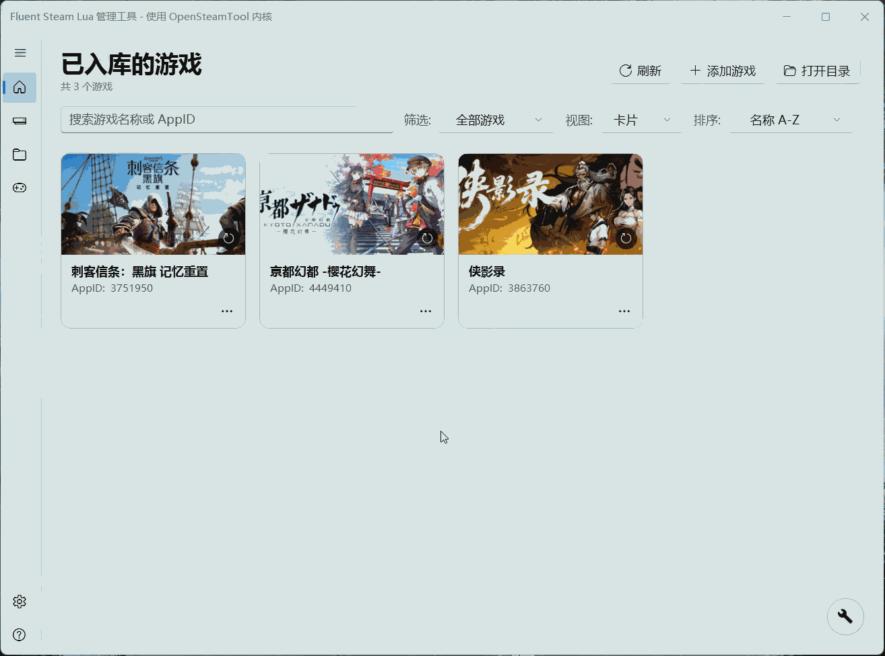
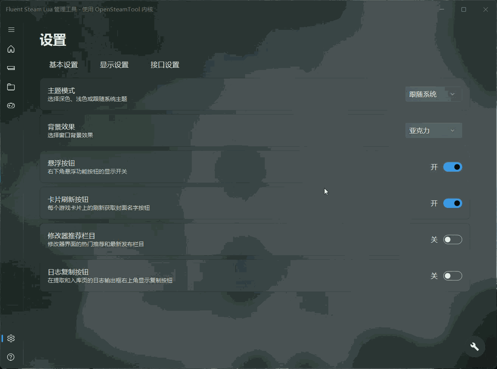
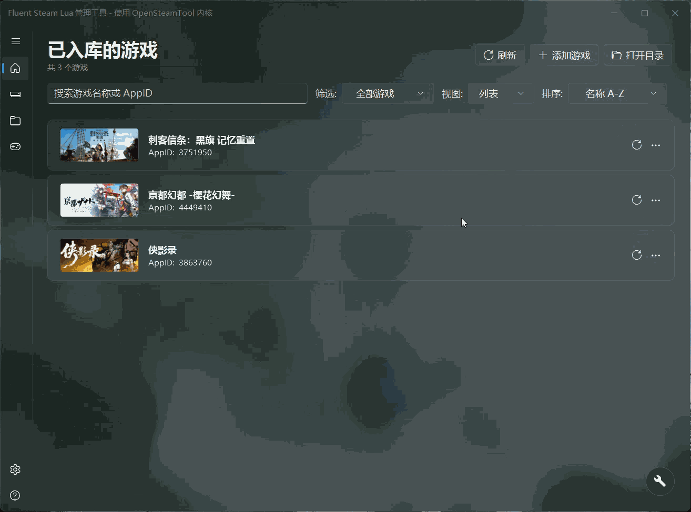
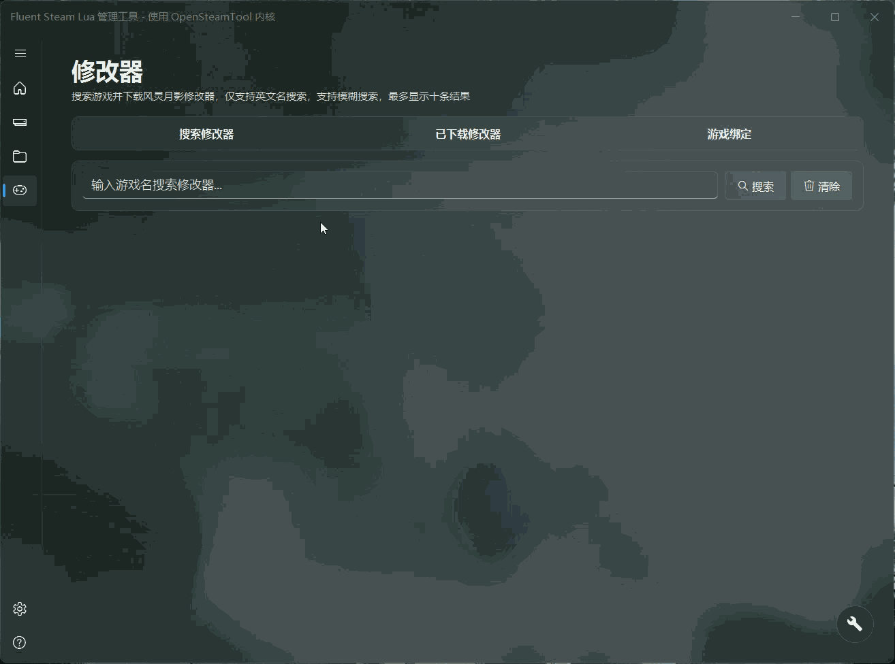

# Fluent Steam Lua Manager

<p>
  <a href="README.md">
    
    简体中文
  </a>
  &nbsp;|&nbsp;
  <a href="README.en.md">
    
    <b>English</b>
  </a>
</p>

A modern, lightweight Steam Lua library manager built with WPF + Fluent Design. Currently supports OpenSteamTool only.

> Project page: https://huanyuejue.github.io/Fluent-Steam-Lua/

> FSL Telegram group: [Click to join](https://t.me/FluentSL)

## Preview

<table>
  <tr>
    <td align="center">
      
    </td>
    <td align="center">
      
    </td>
  </tr>
  <tr>
    <td align="center">
      
    </td>
    <td align="center">
      
    </td>
  </tr>
</table>

## Features

#### Library Management
- Auto-reads imported games and shows cover art and localized names (three switchable layouts)
- Search and import new games by AppID or game name
- Check DLC import status for the current game's manifest, with one-click DLC completion
- Extract Lua manifests, achievement Bin files and Manifest files from games you own on a retail Steam account
- Quickly disable or enable a game's Lua manifest without deleting it
- Pin a game's manifest to the latest or currently installed version
- Extract and use Denuvo authorization data (appticket and eticket)
- Manifest monitoring auto-fetches manifests to work around download failures caused by network issues
- One-click search and download for 480 and OnlineFix multiplayer patches

#### Trainers
- Search, download and manage game trainers (FLiNG)
- Bind a trainer to a game process so it launches automatically with the game
- After binding, optionally auto-activate specific trainer features when the trainer starts

#### Kernel
- A personally maintained fork of OpenSteamTool
- Quick install / update / uninstall of the OpenSteamTool kernel
- Customizable scan location for Lua manifest files
- Broadcast real play status to friends for Lua-imported games
- Hot-switch the upstream manifest source used by the kernel

#### Steam
- Quick launch and restart Steam
- Quick switch between Steam accounts with saved local credentials
- Manage achievement data for owned games with cloud backup (unlock / re-lock)

#### Cloud Save Redirection
- Built on [CloudRedirect](https://github.com/huanyuejue/CloudRedirect)
- Redirects Steam cloud saves of Lua-imported games to a storage location of your choice, fixing cloud save errors
- Six storage backends: local folder, Google Drive, OneDrive, Cloudflare R2, S3-compatible storage and WebDAV, switchable at any time in the UI
- Toggling and storage location changes take effect after a Steam restart; achievements and playtime still sync to cloud
- The target directory supports custom paths and one-click reset to default; switching locations migrates existing saves
- Lists and manages redirected games, with one-click open path and clear saves (restores the game to its original state)
- Deleting saves backs up and verifies the full data first; it only proceeds after verification, and backups can be copied back manually

#### Steam-Free Launch
- One-click SteamStub removal and Goldberg emulator deployment, letting games run without Steam while achievements still pop
- Supports restoring the crack; the emulator can be downloaded/updated (download source follows the mirror preference in settings, auto-switching between direct and mirror)
- Built-in AppID lookup: search candidates by game folder name and fill in
- Optional Steam Web API Key: fills in achievement and inventory info when provided, skipped otherwise, does not affect cracking
- Note: works only for SteamStub games; Denuvo-protected games are not supported

#### Other
- Automatic file change monitoring and cache refresh
- Modern Fluent Design interface, built with WPF for easy debugging
- Theme support: follow system / dark / light
- Backdrop support: Acrylic / Mica / none
- Multi-language UI (Simplified Chinese / English), switchable in settings with immediate effect and no restart
- Automatic update check (can be disabled)
- Built-in issue feedback channel

## Requirements

- Windows 10 1809+ / Windows 11
- [.NET 8 Runtime](https://dotnet.microsoft.com/download/dotnet/8.0)

## Building

Prerequisites: [.NET 8 SDK](https://dotnet.microsoft.com/download/dotnet/8.0). The build automatically fetches the CloudRedirect native DLL (following the latest release of the maintained repo by default, requires network, with SHA256 verification). To reproduce an older build, pin the version: `dotnet build -p:CloudRedirectVersion=v2.6.5`.

Publish as a single-file executable:

```cmd
dotnet publish SteamLuaManager.csproj -c Release -r win-x64 --self-contained false -p:DebugType=none -p:AppExeName="Fluent Steam Lua" -p:PublishSingleFile=true -o publish/single
```

Publish as loose files:

```cmd
dotnet publish SteamLuaManager.csproj -c Release -r win-x64 --self-contained false -p:DebugType=none -o publish/loose
```
